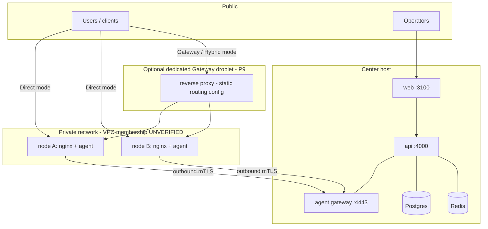

# pPanel — Network Topology

Status: v1 baseline (2026-11-17). Brief §13.1, design §10.2. **No production network change is planned or authorized.**

## 1. Planes — keep them separate

| Plane                    | Path                                                                                                        | Direction                  | Notes                          |
| ------------------------ | ----------------------------------------------------------------------------------------------------------- | -------------------------- | ------------------------------ |
| **Management (control)** | Agent → Center agent gateway `:4443` (mTLS) ; Agent → Center API `:4000` (enrollment only)                  | **outbound from host**     | no listener on managed hosts   |
| **Operator UI/API**      | Browser → Web `:3100` / API `:4000` (behind TLS reverse proxy in prod)                                      | inbound to Center          |                                |
| **Application traffic**  | Clients → existing Nginx on each host (Direct) **or** → optional pPanel Gateway → backends (Gateway/Hybrid) | inbound to hosts / Gateway | never through the Center       |
| **Human SSH (P10)**      | Browser → WebSocket → Center SSH gateway → host `sshd`                                                      | Center → host              | separate from management plane |

## 2. Center vs optional Gateway

- **Center = control plane only.** Its outage stops management (UI, deploys, jobs) but **not workloads**:
  hosts keep serving via their own Nginx (Direct) or via the Gateway, whose routing config is
  stateless/local and does not query the Center per request (brief §13.1).
- **Gateway is a separate process on a separate (recommended) droplet** — a single ingress and
  therefore a potential outage point (risk R-05). HA is **not** claimed without a working failover design (P14-T2).
- Per-domain mode: **Direct** (existing, default), **Gateway** (opt-in), **Hybrid**. Cutover requires
  shadow test via Host/SNI override, TLS readiness, backend health, DNS change by the operator, and a
  rollback plan. No zero-downtime promise for DNS cutover.

## 3. DigitalOcean VPC — what is and is not known

| Fact                                   | Status                   | Evidence                                                                              |
| -------------------------------------- | ------------------------ | ------------------------------------------------------------------------------------- |
| Droplets are in the same region        | user-stated              | not independently verified                                                            |
| Droplets have private IPv4 addresses   | user-stated              | not independently verified                                                            |
| Private IPs ping each other            | user-stated              | ping result reported by user                                                          |
| Droplets share one VPC (same VPC UUID) | **UNVERIFIED — BLOCKED** | **ping ≠ same VPC**: reachability can also come from VPC peering or other routing     |
| VPC UUID(s), peering, routes           | **UNVERIFIED — BLOCKED** | requires read-only DO API token (droplet:read, vpc:read) or a user-supplied inventory |

**BLOCKED (P9-01):** VPC UUID/membership stays unknown until the user supplies **DigitalOcean
read-only API credentials** or a **manual inventory** (droplet ID, VPC UUID, private/public IPs, region,
cloud-firewall IDs). Until then pPanel stores addresses with `source: detected|override` and
`verifiedAt`, and the UI must show "private reachable" independently from "same VPC".

## 4. Connection policy (per server)

`auto | private_preferred | private_only | public_preferred | public_only` (API_CONTRACTS §3).

- `private_only` **fails closed**: if the private path is down, no fallback to public (P9-T2).
- Any fallback private→public is audited and must be allowed by policy (brief §15.2).
- Editing endpoint metadata in pPanel **never** edits netplan, interfaces, routes or public IPs.

## 5. Ports

| Port  | Service            | Bind (dev)                                  | Prod exposure                                                       |
| ----- | ------------------ | ------------------------------------------- | ------------------------------------------------------------------- |
| 3100  | web                | localhost                                   | behind TLS reverse proxy, operator access only                      |
| 4000  | API                | localhost                                   | behind TLS reverse proxy; `/api/v1/agent/enroll` reachable by hosts |
| 4443  | agent mTLS gateway | localhost (+`host.docker.internal` for lab) | reachable by managed hosts only (private path preferred)            |
| 55432 | Postgres (dev)     | 127.0.0.1                                   | never public                                                        |
| 56379 | Redis (dev)        | 127.0.0.1                                   | never public                                                        |
| —     | managed hosts      | —                                           | **no pPanel inbound port**                                          |

## 6. Lab mapping

The lab (`infra/compose/lab.yml`) uses one bridge network `ppanel-lab-net`; nodes reach the Center on
the Mac via `host.docker.internal` (host-gateway). This simulates only "outbound to Center"; it does
not simulate VPCs, public/private dual addressing or cloud firewalls (see `infra/lab/README.md`).

## 7. Rollback

No routing change is made in P0–P8. For P9 Gateway cutover the rollback is: revert DNS to previous
records (operator-owned), keep Direct-mode Nginx untouched during shadow testing, and keep Gateway
routing config versioned so a previous version can be re-applied without the Center.
