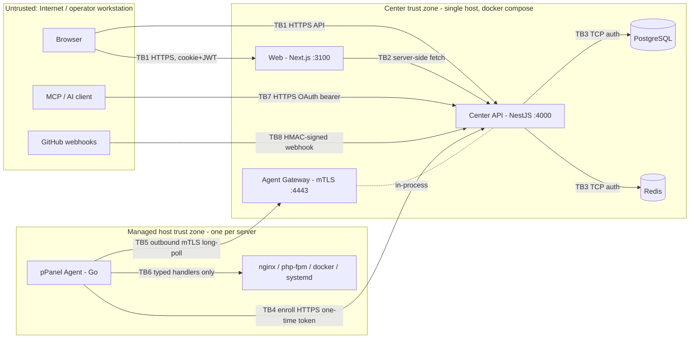

# pPanel — Security Threat Model (P0.05)

Status: v1 baseline, 2026-11-17. Owner: platform/security. Re-review at every phase gate and whenever
a trust boundary, protocol or privileged capability changes. Brief references: §3 (security
architecture), §14 (reference constraints), §15 (MCP), `docs/API_CONTRACTS.md`, `docs/AGENT_PROTOCOL.md`.

## 1. Assets

| ID  | Asset                                                              | Why it matters                                                | Where                                                          |
| --- | ------------------------------------------------------------------ | ------------------------------------------------------------- | -------------------------------------------------------------- |
| A1  | Internal agent CA private key (ECDSA P-256)                        | Mints agent identities and gateway cert → fleet impersonation | `ca_keys` (AES-256-GCM encrypted with `PPANEL_MASTER_KEY`)     |
| A2  | `PPANEL_MASTER_KEY`, `JWT_ACCESS_SECRET`                           | Decrypt all secrets / forge sessions                          | env of API process; backed up separately from DB (ADR-0006)    |
| A3  | User credentials, TOTP secrets, recovery codes                     | Account takeover                                              | `users`, `mfa_factors` (argon2id / encrypted)                  |
| A4  | Session refresh tokens, access JWTs                                | Session hijack                                                | HttpOnly cookie / memory; sha256 at rest                       |
| A5  | Enrollment tokens                                                  | Rogue agent enrollment                                        | shown once; sha256 at rest, 5–60 min TTL, single use           |
| A6  | Agent private keys + leaf certs                                    | Impersonate a server, receive its tasks                       | managed host `/var/lib/ppanel-agent` (0600), never leaves host |
| A7  | Managed hosts (root-equivalent via agent + Docker)                 | Full host compromise                                          | every enrolled server                                          |
| A8  | Existing Nginx configs / TLS keys on hosts                         | Outage, traffic hijack                                        | hosts; read-only by default                                    |
| A9  | App secrets, registry/GitHub creds, SSH private keys, DB passwords | Lateral movement                                              | `secrets` (envelope encrypted), returned only as `{ref,set}`   |
| A10 | Audit log                                                          | Accountability / forensics                                    | `audit_events` append-only                                     |
| A11 | Backups (restic repos, DB dumps) and their keys                    | Data loss / exfiltration                                      | offsite repo; delete creds separate from Center admin          |
| A12 | Job queue / leases                                                 | Replay of privileged actions                                  | Postgres `job_leases` (+ Redis later)                          |
| A13 | Availability of existing workloads                                 | Business impact                                               | hosts; must not depend on Center                               |
| A14 | MCP client credentials / AI automation policies                    | Ungoverned automated mutation                                 | P13                                                            |

## 2. Trust boundaries

Text form: `browser ⇄(TB1) web ⇄(TB2) API ⇄(TB3) DB/Redis`; `API ⇄ agent gateway` in-process;
`agent →(TB4/TB5, agent-initiated) gateway`; `agent →(TB6) host services`;
`MCP client →(TB7) API`; `GitHub →(TB8) API`. No inbound listener exists on managed hosts.

## 3. STRIDE per boundary

| TB                  | Threat (STRIDE) | Scenario                                                               | Mitigation (brief ref)                                                                                                                              | Test                           |
| ------------------- | --------------- | ---------------------------------------------------------------------- | --------------------------------------------------------------------------------------------------------------------------------------------------- | ------------------------------ |
| TB1 browser↔web/API | S               | credential stuffing / phishing                                         | argon2id, rate limit 5/min → 429, TOTP MFA, step-up for prod (§3)                                                                                   | P1-T03, P7-T01                 |
| TB1                 | T               | CSRF on cookie-auth refresh                                            | refresh cookie `SameSite=Strict`, `Path=/api/v1/auth`, `X-CSRF` header required; access token in memory, Bearer                                     | P7.01                          |
| TB1                 | I               | XSS steals tokens / SSH keys                                           | no tokens in localStorage, CSP, React escaping, private keys never sent to browser (§14.2)                                                          | P10-T3, P7.01                  |
| TB1                 | E               | IDOR / broken access control                                           | server-side scoped RBAC on every endpoint + per-entity scope check; UI state derived from `allowedActions` (§3, §11)                                | P1-T03, P5-T02, E2E-16         |
| TB1                 | R               | user denies destructive action                                         | audit actor/target/before-after hash/approval/requestId (§3)                                                                                        | P6-T03                         |
| TB2 web↔API         | S/T             | SSR forwarding forged identity headers                                 | web forwards only the user's Bearer; API never trusts web-supplied identity                                                                         | P1-T03                         |
| TB3 API↔DB/Redis    | I               | DB dump exposes secrets                                                | envelope encryption, secret refs, hashed tokens; DB/Redis bound to 127.0.0.1/private network                                                        | P7-T03                         |
| TB3                 | T               | Redis tampering with jobs                                              | Postgres is durable source of truth for leases (ADR-0003); Redis only scheduling hints                                                              | P2-T03                         |
| TB4 enrollment      | S               | stolen/reused/expired token                                            | single use in same TX, sha256 at rest, TTL ≤60 min, uniform error (no oracle), rate limit 10/min/IP (AGENT_PROTOCOL)                                | P1-T01                         |
| TB4                 | T               | attacker supplies CSR subject                                          | Center ignores CSR subject, sets CN/SAN itself; ECDSA P-256 only                                                                                    | P1-T02                         |
| TB5 agent↔gateway   | S               | spoofed agent cert / revoked cert                                      | `requestCert+rejectUnauthorized`, CA = internal CA, serial must exist & not revoked, server not revoked                                             | P1-T02                         |
| TB5                 | T/R             | replay of task grant / stale privileged job                            | `expiresAt` + 30 s skew, lease token, idempotency key, completed-jobId cache (1000), mutating jobs never re-leased → `expired` (§3, AGENT_PROTOCOL) | P2-T01, P2-T02, P7-T02, E2E-11 |
| TB5                 | D               | gateway flood / long-poll exhaustion                                   | per-cert concurrency 1 long-poll, body limits, rate limits                                                                                          | P7.06                          |
| TB5                 | I               | MITM on Center↔agent                                                   | mTLS both ways, agent pins CA from enrollment response                                                                                              | P1-T02                         |
| TB6 agent→host      | E               | agent becomes generic root shell                                       | **typed handlers only**, allowlisted job types, Zod + Go validation, owned-resource allowlist (ADR-0005, §14.1)                                     | P2-T02, P7.02                  |
| TB6                 | T               | path traversal/symlink in nginx edit                                   | canonicalize, reject outside roots/symlinks, snapshot + `nginx -t` + approved reload + postcheck/revert (§3)                                        | P3-T03, P3-T04, P7-T04         |
| TB6                 | E               | malicious compose (privileged, host mounts, host net/pid, docker.sock) | static policy validator rejects (§5)                                                                                                                | P4-T05                         |
| TB6                 | D               | read-only import mutates/reloads                                       | discovery handlers never write/reload; checksum + master start-time proof                                                                           | P3-T01, E2E-03                 |
| TB7 MCP/AI          | S               | anonymous / wrong audience token                                       | OAuth resource server, issuer+audience checks, revocation (§14.4)                                                                                   | P13-T1                         |
| TB7                 | E               | AI self-approves / scope escalation                                    | approvals human-only, bound to plan hash + artifact digest + target + expiry (§14.6)                                                                | P13-T2, P13-T3                 |
| TB7                 | T               | prompt injection in repo/logs changes policy                           | tool output = untrusted data; policy engine independent of instructions (§14.5)                                                                     | P13-T5                         |
| TB8 GitHub          | S/R             | spoofed / replayed webhook                                             | HMAC signature, delivery-ID dedupe, SHA pinning, branch allowlist (§5)                                                                              | P4-T06, E2E-08                 |
| TB8                 | E               | SSRF via healthcheck/target URLs                                       | allowlist schemes/hosts, block link-local/metadata ranges, resolve-then-connect checks (§3)                                                         | P7.01                          |
| All                 | I               | secrets in logs/responses                                              | redaction middleware, `{ref,set}` responses, structured logs without PII/secrets                                                                    | P4-T02, P5-T03, P14-T3         |

## 4. Operation classification

| Class           | Definition                                           | Controls                                                                                                                                  | Examples                                                                                                                                                           |
| --------------- | ---------------------------------------------------- | ----------------------------------------------------------------------------------------------------------------------------------------- | ------------------------------------------------------------------------------------------------------------------------------------------------------------------ |
| **read**        | no state change anywhere                             | `*.read` perm, scope filter, audit for sensitive reads                                                                                    | list servers, view nginx config, logs query, `inventory.collect`, `discovery.scan`                                                                                 |
| **write**       | changes Center state only (no host effect)           | write perm, `If-Match` version, audit                                                                                                     | rename server, tags, connection policy metadata, alert rule CRUD, backup policy draft                                                                              |
| **privileged**  | changes host/runtime state, reversible               | perm + scope + idempotency + lease/TTL + preflight; **step-up MFA for production**; approval per policy                                   | `service.restart`, `nginx.apply` (with revert), deploy, rollback, cert rotate, firewall apply (timed rollback), plugin install, SSH session open                   |
| **destructive** | irreversible or data-overwriting, or lockout-capable | privileged controls **plus** mandatory human approval bound to plan hash, dry-run/impact, isolated target by default, never auto-replayed | restore over data, server revoke, volume/DB delete, firewall policy that touches management path, plugin uninstall of data services, secret rotation of live creds |

Job types in `API_CONTRACTS.md` §5: `inventory.collect`/`discovery.scan` = read (re-leasable);
`service.restart`, `nginx.validate`(read-ish, still leased), `nginx.apply` = privileged (never re-leased after expiry).

## 5. Mitigation map to brief §3 / §14

| Brief requirement                                                          | Mitigation in pPanel                                                            | ADR / doc                       |
| -------------------------------------------------------------------------- | ------------------------------------------------------------------------------- | ------------------------------- |
| §3 mTLS, per-agent identity, rotation/revocation, no public agent listener | outbound long-poll, internal CA, 7-day leaf certs, revocation check per request | ADR-0002, ADR-0006              |
| §3 one-time enrollment token                                               | sha256, TTL, single-use TX, uniform errors                                      | AGENT_PROTOCOL                  |
| §3 scoped RBAC + MFA for privileged prod                                   | `RoleBinding` scopes, `X-Step-Up` token                                         | API_CONTRACTS §1–2              |
| §3 no docker.sock in web/API                                               | only agent touches Docker; API/web containers never mount it                    | ADR-0001, ADR-0005              |
| §3 Docker root = host-equivalent                                           | dedicated trusted nodes; documented risk R-01                                   | RISKS                           |
| §3 nginx ownership safety                                                  | targeted managed includes, snapshot, `nginx -t`, postcheck/revert, drift block  | ADR-0004                        |
| §3 SSRF/replay/injection/malicious compose                                 | validators + tests P4-T05, P7.01                                                | —                               |
| §3 jobs: idempotency/expiry/lease/preflight/version                        | Postgres-durable leases                                                         | ADR-0003                        |
| §3 read-only import                                                        | discovery handlers read-only, proven by checksum script                         | `scripts/lab/checksum-nginx.sh` |
| §3 audit with redaction                                                    | `audit_events` row per mutation, diffHash                                       | API_CONTRACTS §0                |
| §14.1 no generic command execution                                         | typed handlers only                                                             | ADR-0005                        |
| §14.2 SSH for humans only, keys never in browser                           | P10 SSH gateway design                                                          | `SSH_SECURITY.md` (P10)         |
| §14.3 firewall safety                                                      | timed rollback outside request lifecycle, mgmt-path validator                   | `FIREWALL_POLICY.md` (P11)      |
| §14.4 MCP OAuth/audience/origin                                            | P13                                                                             | `MCP_AUTH.md` (P13)             |
| §14.5 prompt injection boundary                                            | policy engine independent of tool text                                          | `AI_APPROVAL_POLICY.md` (P13)   |
| §14.6 approval binding                                                     | plan hash + digest + target + expiry, single use                                | ADR (P13)                       |
| §14.7 sensitive ops risk categories                                        | classification table §4 above                                                   | this doc                        |

## 6. Residual risks / open items

See `docs/RISKS.md`. Notably: Docker-root host equivalence (accepted, documented), CA key compromise
(mitigated by encryption + separate key backup, not HSM in v1), Center compromise = fleet control
(mitigated by typed handlers and approvals, not eliminated).
